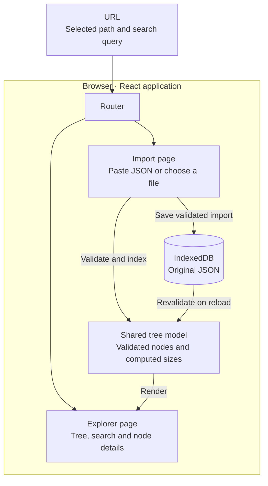
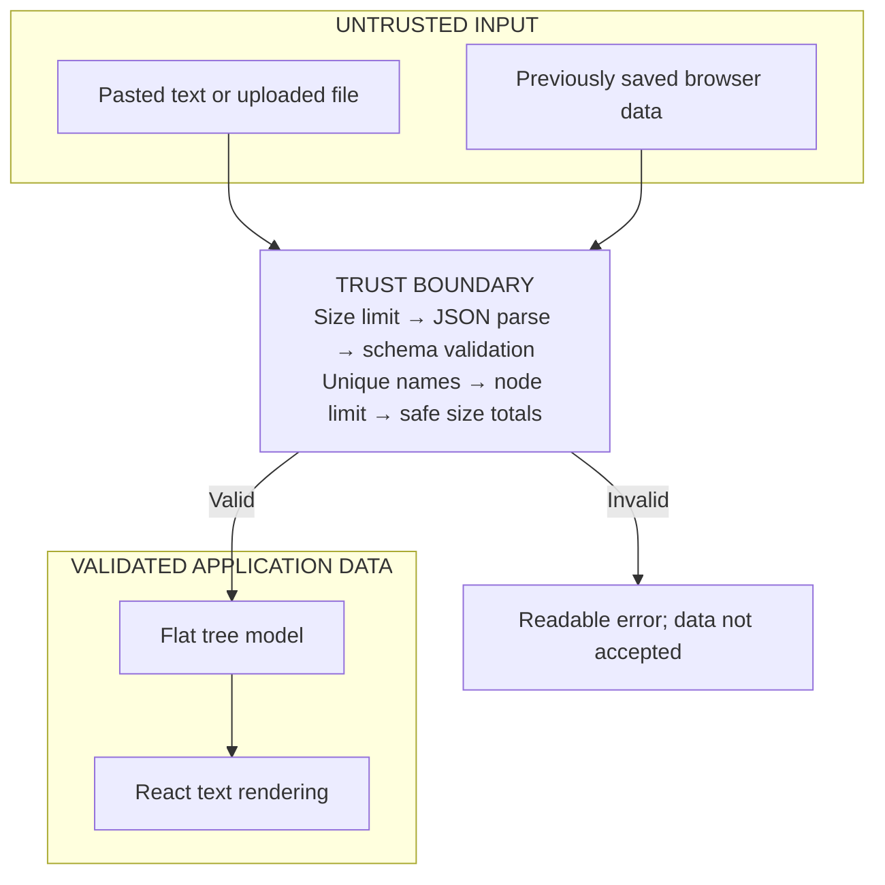

# FileTree Explorer

A React and TypeScript app for browsing a file tree imported from JSON. Paste JSON or upload a file, expand folders, search by name, and view file or folder details. All data stays in the browser.

## Run locally

Requires Node.js 24.x and npm. The Node version is set in `.nvmrc`.

```bash
npm install
npm run dev
```

Open http://localhost:5173. Use `npm ci` instead of `npm install` for a clean install with the versions in the lockfile.

## Design decisions



- React Context holds the active tree. This single-user app does not need a backend or another state library.
- Plain TypeScript functions validate the JSON, calculate folder sizes, and search the tree. React components display the results and handle user input.
- The model stores nodes in a flat list with links to their parents and children. It processes the tree without recursive function calls, so deeply nested folders do not exhaust the call stack. It calculates folder sizes once per import.
- React Router handles `/` for import, `/tree` for browsing, and `/tree/:nodePath` for details. Paths include the root folder name. The `q` URL parameter stores the search query.
- IndexedDB saves the imported JSON and restores it on reload. The app validates saved data again before using it. If saving a new import fails, the previous tree stays available.
- SCSS Modules keep styles local to each component. Lucide provides icons.

## Input format

See [example JSON](public/example.json).

- The root must be a folder. Each folder needs a `children` array.
- Files need a non-negative integer `size` in bytes and cannot have children. File sizes and folder totals must fit within JavaScript's safe integer range.
- Names within the same folder must be unique. Names cannot be blank or contain invalid Unicode, slashes, backslashes, or control characters. `.` and `..` are also rejected.
- The app ignores unknown properties.

## Limits and saved state

Imports can contain up to 2 MiB of JSON and 10,000 files and folders. There is no fixed nesting limit, but indentation stops increasing after 12 levels.

Search ignores letter case and counts all matches. It shows 100 results at a time, with a button to load more. A new query resets the displayed results. Expanding many folders or loading many results can slow the page down.

The app saves one tree. A successful import replaces it. Saved data belongs to the current browser profile and site address. Clearing site storage deletes it. Sharing a link does not share the tree.

Expanded folders stay open when switching between search and browsing. Reloading resets expansion, but the app opens the selected node's parent folders so the selection is visible.

Sizes use B, KB, and MB, with 1 KB equal to 1024 bytes.

## Data safety and deployment



The app checks both imports and saved data before displaying them. Names appear as text, never HTML. Paths refer to entries in the imported tree and do not access the computer's filesystem.

Browser storage is not encrypted. Other users of the same browser profile can access it. Selected paths and search queries may appear in browser history.

`npm run dev` is for local development. There is no production deployment setup. To deploy, serve the built `dist` folder over HTTPS, configure security headers, and return `index.html` for app routes so direct links work.

React Router v6 is required by the assignment. The previous dependency audit reported two moderate findings involving redirects and server-rendered pages. This app does not render on the server and builds internal links from validated names. Run `npm audit` again and resolve remaining findings before deployment.

## Checks

```bash
npm test
npm run typecheck
npm run build
npm run format:check
```

Use `npm run test:watch` to rerun unit tests while editing.

Vitest and React Testing Library check validation, deep nesting, sizes, import, navigation, search, folder expansion, and storage failures.

## Performance

Search checks every node and reuses the results until the tree or query changes. The app builds full paths only for displayed search results. Storing every path would use excessive memory for deeply nested trees.

The tree view does not render while search results are visible. When browsing, the app reuses the list of visible rows until the tree or expanded folders change. These choices reduce work, but performance has not been benchmarked.

## With more time

- Save multiple named trees, with switching, renaming, deletion, and JSON export.
- Measure performance on larger trees. If needed, render only rows currently on screen and move parsing or search to a background Web Worker.
- Add browser tests for keyboard navigation and run the checks automatically in CI.
- Add production hosting configuration, a Content Security Policy, and updated dependencies.
